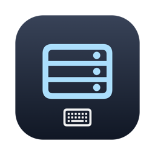

<div align="center">

<picture>
  <source media="(prefers-color-scheme: dark)" srcset="assets/readme/banner-dark.svg">
  <source media="(prefers-color-scheme: light)" srcset="assets/readme/banner-light.svg">
  
</picture>

<br>

<a href="https://github.com/successful-accident/megarac-console/actions/workflows/test.yml"></a>
<a href="LICENSE"></a>
<a href="https://github.com/successful-accident/megarac-console/releases/latest"></a>
<a href="#install"></a>

<a href="#install">Install</a> &nbsp;·&nbsp;
<a href="#use">Use</a> &nbsp;·&nbsp;
<a href="#troubleshooting">Troubleshooting</a> &nbsp;·&nbsp;
<a href="#platform-status">Platforms</a> &nbsp;·&nbsp;
<a href="#how-it-works">How it works</a> &nbsp;·&nbsp;
<a href="#development">Development</a>

</div>

<br>

Opens the Java remote console (KVM) of older AMI MegaRAC SP BMCs on today's
macOS, Linux, FreeBSD and Windows, with no browser and no Java Web Start.

These BMCs offer their console only as a Java Web Start launch file, which no
current browser or Java will run. MegaRAC Console does the launch itself:

<picture>
  <source media="(prefers-color-scheme: dark)" srcset="assets/readme/flow-dark.svg">
  <source media="(prefers-color-scheme: light)" srcset="assets/readme/flow-light.svg">
  
</picture>

The viewer runs with fixes:

<picture>
  <source media="(prefers-color-scheme: dark)" srcset="assets/readme/features-dark.svg">
  <source media="(prefers-color-scheme: light)" srcset="assets/readme/features-light.svg">
  
</picture>

Except on Windows, which uses the BMC's own media libraries, the viewer's media
libraries are replaced by `src/media.c`, built for each platform. The BMC's own
libraries don't load on Apple silicon, Linux on ARM or FreeBSD.
`media.c` mounts ISO images.

> [!NOTE]
> It suits BMCs whose web interface has a "Launch KVM" or "Java console" button
> that downloads a `jviewer.jnlp` file. Newer MegaRAC SP-X firmware has an HTML5
> console in the browser and doesn't need this.

<picture>
  <source media="(prefers-color-scheme: dark)" srcset="assets/readme/divider-dark.svg">
  <source media="(prefers-color-scheme: light)" srcset="assets/readme/divider-light.svg">
  
</picture>

## Install

One command installs the latest release, and running it again updates it. Each
release carries its own Java 8, so there's nothing to install first.

**macOS** (Apple silicon or Intel) **and Linux** (x86_64 or aarch64):
```sh
curl -fsSL https://raw.githubusercontent.com/successful-accident/megarac-console/main/install.sh | sh
```

**Windows** (x64, or ARM64 under emulation), in PowerShell:
```powershell
irm https://raw.githubusercontent.com/successful-accident/megarac-console/main/install.ps1 | iex
```

Then open **MegaRAC Console** from Launchpad, the application menu or the Start
menu, or run `megarac-console` in a new terminal.

<details>
<summary><b>Download a package instead</b></summary>

<br>

| Platform | Package | To run it |
|---|---|---|
| macOS, Apple silicon | [megarac-console-macos-arm64.dmg](https://github.com/successful-accident/megarac-console/releases/latest/download/megarac-console-macos-arm64.dmg) | Drag the app to Applications |
| macOS, Intel | [megarac-console-macos-x64.dmg](https://github.com/successful-accident/megarac-console/releases/latest/download/megarac-console-macos-x64.dmg) | Drag the app to Applications |
| Linux x86_64 | [megarac-console-linux-x86_64.tar.gz](https://github.com/successful-accident/megarac-console/releases/latest/download/megarac-console-linux-x86_64.tar.gz) | `tar xzf` it, then run `megarac-console/megarac-console` |
| Linux aarch64 | [megarac-console-linux-aarch64.tar.gz](https://github.com/successful-accident/megarac-console/releases/latest/download/megarac-console-linux-aarch64.tar.gz) | the same |
| Windows x64 | [megarac-console-windows-x64-setup.exe](https://github.com/successful-accident/megarac-console/releases/latest/download/megarac-console-windows-x64-setup.exe) | Run it; it installs for you alone, with no administrator rights |

The packages aren't signed, so the first launch of a downloaded one gets a warning:
- macOS blocks the app. Open **System Settings → Privacy & Security** and choose
  **Open Anyway**. The install command doesn't hit this, because `curl` doesn't
  mark what it downloads.
- Windows SmartScreen says it protected your PC. Choose **More info → Run anyway**.

</details>

<details>
<summary><b>FreeBSD</b> &nbsp;·&nbsp; amd64, built from source</summary>

<br>

There's no FreeBSD package, so the install command builds the `main` branch with
the system's Java 8 and C compiler:
```sh
pkg install openjdk8 libsecret
fetch -o - https://raw.githubusercontent.com/successful-accident/megarac-console/main/install.sh | sh
```
As the openjdk8 package says, Java needs `fdesc /dev/fd fdescfs rw 0 0` and
`proc /proc procfs rw 0 0` in `/etc/fstab`, then `mount -a`.

</details>

<details>
<summary><b>Build from source</b> &nbsp;·&nbsp; any platform</summary>

<br>

Run from a git checkout, the same scripts build MegaRAC Console with a **Java 8
JDK** on your machine instead of downloading a release. It has to be a JDK, not
a JRE, and not a newer Java: the launcher compiles a small wrapper against your
BMC's viewer. macOS and Linux also need a C compiler. The installed app looks
for Java 8 at every launch, so updating Java doesn't break it.

```sh
git clone https://github.com/successful-accident/megarac-console
cd megarac-console && ./install.sh
```
On Windows, run `powershell -ExecutionPolicy Bypass -File .\install.ps1` in the
checkout instead. Its Start-menu shortcut runs `launch.ps1`, which takes `-Iso`,
`-Diagnose` and `-Forget`.

| Platform | Java 8 JDK and compiler |
|---|---|
| macOS | `brew install --cask zulu@8`, and `xcode-select --install` if there's no C compiler yet |
| Ubuntu | `openjdk-8-jdk gcc libsecret-tools` |
| Debian 12 and later | Temurin 8 from [Adoptium's apt repository](https://adoptium.net/installation/linux/) (`temurin-8-jdk`), plus `gcc libsecret-tools` |
| Fedora | Temurin 8 from Adoptium's rpm repository, plus `gcc libsecret` |
| Arch | `jdk8-openjdk gcc libsecret` |
| Windows | `winget install --id EclipseAdoptium.Temurin.8.JDK -e` |

On Linux, install the JDK with its desktop libraries, not the "headless" package.
`JAVA_HOME` picks a particular JDK (Windows: `-JavaHome <dir>`). To update, run
`git pull`, then the installer again.

</details>

## Use

Open MegaRAC Console. The first run asks for the BMC's address, user and
password. The login is saved after the BMC accepts it:
- macOS: the Keychain.
- Linux and FreeBSD: the Secret Service, via `secret-tool`
  (Debian and Ubuntu: `libsecret-tools`). Without it, the login is asked for
  every time.
- Windows: a file encrypted for your Windows account (DPAPI).

The same command works on every platform:

| Command | What it does |
|---|---|
| `megarac-console` | open the console |
| `megarac-console --host <address>` | open a different BMC than the saved one, without saving it |
| `megarac-console --iso <image.iso>` | mount that image as the server's virtual CD once video starts; the log shows how much the server has read |
| `megarac-console --diagnose` | check TLS, the login and the launch file, then print a report with every secret removed; attach it to a bug report |
| `megarac-console forget` | delete the saved login and address |

The installer puts the command in `~/.local/bin` on macOS and Linux, and says so
if that folder isn't on your `PATH`. On Windows it's on `PATH` in any terminal
opened after the install. The viewer's own Media menu can also mount an image at
any time. The environment variables `BMC_HOST` and `BMC_ISO` do the same as
`--host` and `--iso`.

`MEGARAC_JAVA_OPTS` passes extra options to the viewer's Java, for example
`-Dsun.java2d.uiScale=2` on a HiDPI Linux screen. On macOS and Linux,
`MEGARAC_JAVA_HOME` runs it on a different Java 8 than the one it came with.

## Where things are kept, and uninstalling

| | macOS | Linux and FreeBSD | Windows |
|---|---|---|---|
| App | `/Applications/MegaRAC Console.app`, `~/.local/bin/megarac-console` | `~/.local/share/megarac-console`, `~/.local/bin/megarac-console`, `~/.local/share/applications/megarac-console.desktop` | `%LOCALAPPDATA%\megarac-console\app`, the Start-menu shortcut, an entry on your `PATH` |
| Viewer jars from the BMC | `~/Library/Caches/megarac-console` | `~/.cache/megarac-console` | `%LOCALAPPDATA%\megarac-console\cache` |
| Log of the last run | `~/Library/Logs/megarac-console.log` | `~/.local/state/megarac-console/megarac-console.log` | `%LOCALAPPDATA%\megarac-console\megarac-console.log` |
| Saved login | Keychain, `megarac-console:<address>` | Secret Service, `megarac-console:<address>` | `%LOCALAPPDATA%\megarac-console\login-<address>.txt` |
| Address and window size | Java preferences, node `megarac-console` | `~/.java/.userPrefs/megarac-console` | registry, `HKCU\Software\JavaSoft\Prefs\megarac-console` |

To uninstall:
1. Delete each saved login: `megarac-console --host <address> forget` for every
   BMC you used.
2. Remove the app:
   - macOS and Linux: `curl -fsSL https://raw.githubusercontent.com/successful-accident/megarac-console/main/install.sh | sh -s -- --uninstall`,
     or `./install.sh --uninstall` in a checkout.
   - Windows: **Settings → Apps → MegaRAC Console → Uninstall**, or
     `.\install.ps1 -Uninstall` in a checkout.
3. Delete the cache, the log, and the address and window size from the table.
   On Windows that means the whole `%LOCALAPPDATA%\megarac-console` folder, plus
   `Remove-Item -Recurse HKCU:\Software\JavaSoft\Prefs\megarac-console`.

The log never contains the password, the session cookie, the CSRF token or the
console token. The viewer gets the cookie and token on its input, not on its
command line, so other users of the computer can't see them in a process list.
(If Fit can't be used with your BMC's viewer, the viewer has to take them as
arguments.)

<picture>
  <source media="(prefers-color-scheme: dark)" srcset="assets/readme/divider-dark.svg">
  <source media="(prefers-color-scheme: light)" srcset="assets/readme/divider-light.svg">
  
</picture>

## Troubleshooting

<details>
<summary><b>Older BMCs speak only TLS 1.0 or 1.1, with old keys,</b> which Java 8 now refuses.</summary>

When the first connection fails, MegaRAC Console starts again with
`src/legacy-tls.security`, which allows them, and remembers that for the BMC.
The BMC's self-signed certificate is never checked.

</details>

<details>
<summary><b>"does not compile against this viewer"</b></summary>

Another firmware's viewer differs from the one `src/Fit.java` was written for.
The viewer then runs without Fit's fixes. A `--diagnose` report in an issue
helps make Fit work with it.

</details>

<details>
<summary><b>FreeBSD:</b> the viewer misbehaves</summary>

The viewer was written for Windows, Linux and macOS. If it misbehaves, try
`MEGARAC_JAVA_OPTS=-Dos.name=Linux`.

</details>

<details>
<summary><b>Linux on Wayland</b></summary>

It needs XWayland. Java 8 ignores desktop scaling; use
`MEGARAC_JAVA_OPTS=-Dsun.java2d.uiScale=2`.

</details>

<details>
<summary><b>The BMC allows only four or five web sessions.</b></summary>

MegaRAC Console always logs out, including when the viewer crashes or the
launcher is stopped. A session leaked by something else times out on the BMC.

</details>

## Platform status

"CI" means built, packaged, and tested against a fake BMC on GitHub's runners on
every push, both from source and as the release package. "BMC" means checked by
hand against a real BMC.

| Platform | Media library | Status |
|---|---|---|
| macOS, Apple silicon | `media.c` | CI, and BMC: the console, typing, and booting the server from a mounted ISO |
| macOS, Intel | `media.c` | CI |
| Linux x86_64 and aarch64 | `media.c` | CI |
| FreeBSD amd64 | `media.c` | builds from source; untested, no package |
| Windows x64 (ARM64 under emulation) | the BMC's own | CI |

Not yet confirmed on any machine: the viewer's Full Screen mode.

## Tested hardware

| Server | BMC firmware |
|---|---|
| Quanta D51B-2U | 3.83.00 (the last release) |

Please open an issue with a `--diagnose` report for any other board, whether it
works or not.

<picture>
  <source media="(prefers-color-scheme: dark)" srcset="assets/readme/divider-dark.svg">
  <source media="(prefers-color-scheme: light)" srcset="assets/readme/divider-light.svg">
  
</picture>

## How it works

The BMC's web API, as used here:
1. `POST /rpc/WEBSES/create.asp` with the form fields `WEBVAR_USERNAME` and
   `WEBVAR_PASSWORD`. The reply is JavaScript, not JSON, holding
   `'SESSION_COOKIE' : '…'` and, on newer firmware, `'CSRFTOKEN' : '…'`. A cookie
   starting with `Failure` means the login was refused.
2. Every later request sends `Cookie: SessionCookie=<cookie>` and the header
   `CSRFTOKEN: <token>`.
3. `GET /Java/jviewer.jnlp?EXTRNIP=<address>&JNLPSTR=JViewer`. Its `<argument>`
   elements are the viewer's command line, including a one-time console token.
   Its `<jar>` elements name the viewer jars, under `/Java/release/`. Its
   per-platform `<nativelib>` elements name the media libraries (`Win64.jar` for
   Windows x64).
4. `GET /rpc/WEBSES/logout.asp` when done.

The console itself uses TCP port 7578; virtual media uses 5120, 5122 and 5123.

The launcher (`src/MegaracConsole.java`) runs the viewer in a second Java process
with `java.library.path` pointing at the media libraries, wrapped by
`src/Fit.java`. `src/media.c` implements the three JNI libraries the viewer loads
(`javacdromwrapper`, `javafloppywrapper`, `javaharddiskwrapper`). It is a
line-for-line port of the Intel library's ISO-image code, written to reply to the
server byte for byte as that library does. With `media.c` (every OS but Windows),
physical drives and floppy and hard-disk redirection are not supported.

## Development

```sh
test/test-media.sh "$JAVA_HOME"      # media.c against the recorded replies
test/test-launcher.sh "$JAVA_HOME"   # installs into a temporary home, runs against test/fake_bmc.py
```
`test/test-windows.ps1` is the Windows counterpart; CI runs all three
(`.github/workflows/test.yml`). With `MEGARAC_PACKAGE=<package>`, the launcher
tests install that release package instead and run on the Java 8 inside it.

**Releases.** `.github/package.sh <JDK> <output>` builds the macOS `.dmg` or the
Linux `.tar.gz` with that JDK inside; `.github/megarac-console.iss` is the
Windows installer, built with Inno Setup. CI builds and tests all five on every
push. Pushing a `v*` tag also puts them on a draft release:
```sh
git tag v1.0.0 && git push origin v1.0.0
```
Check the draft, then publish it. The install commands always fetch the latest
published release. The packages carry Azul's Zulu 8, as current as CI's on the
day they're built, so a new tag after each quarterly Java update keeps them
patched.

`test/expected.sha256` holds the replies `media.c` must give. They were recorded
from `media.c` itself and are not yet re-checked against AMI's Intel library;
CI proves every platform's build agrees with them. On a Mac that still has Rosetta
and an Intel Java 8, `test/test-media.sh --intel <Mac64.jar> <jar dir>` re-records
them from the Intel library, after checking that `media.c` matches it on both
architectures. `--diagnose` saves `Mac64.jar` and the viewer jars in the
cache's `diagnose` folder.

The pictures in this README are in `assets/readme/`, a dark and a light version
of each.

## License

GPL-3.0-or-later; see [LICENSE](LICENSE). Copyright (C) 2026 Jeff Morrison.

This repository never contains AMI's viewer or libraries: each BMC serves its
own, and MegaRAC Console downloads them from your BMC to your computer at run
time. Not affiliated with AMI; MegaRAC is a trademark of American Megatrends.

<br>

<p align="center"></p>
